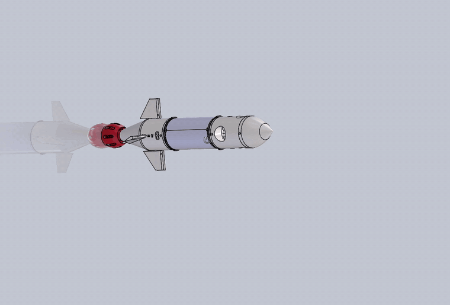
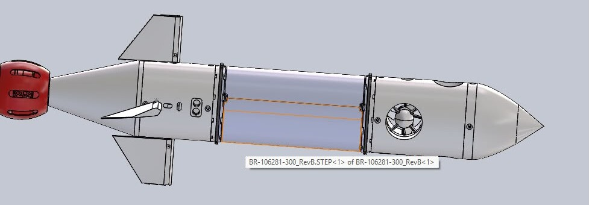
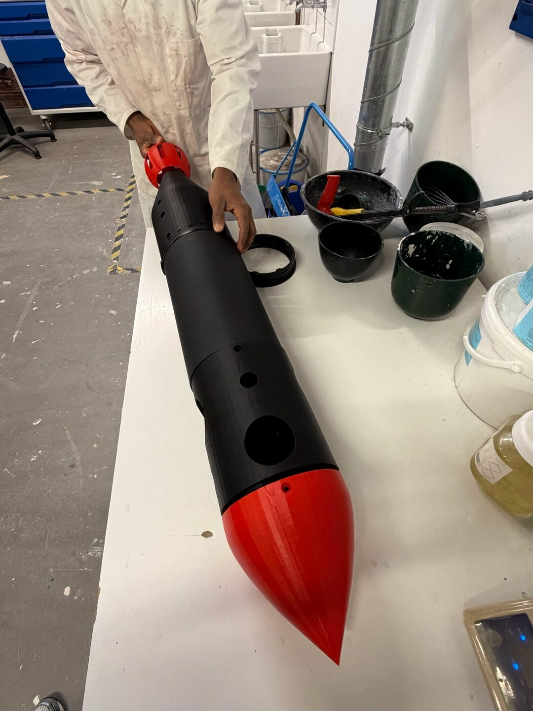
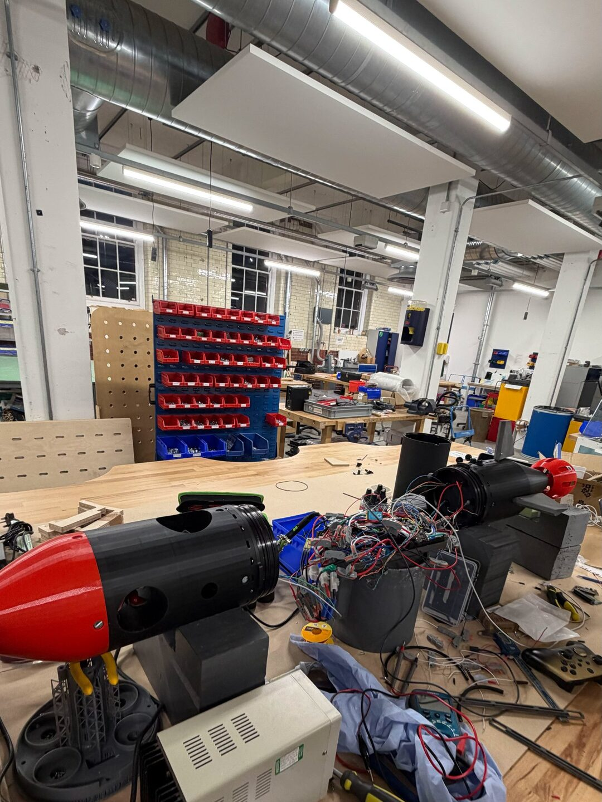

# auv_pi_stack

<p align="center">
  <a href="docs/media/auv_cad_walkthrough.mp4">
    
  </a>
</p>
<p align="center">
  <sub>CAD model of the vehicle · <a href="docs/media/auv_cad_walkthrough.mp4">watch the full 48 s walkthrough</a> · <a href="#the-vehicle">photos of the build ↓</a></sub>
</p>

ROS 2 (Humble) stack for a low-cost AUV: one Raspberry Pi 4, a Pixhawk as
sensor hub and thruster PWM output stage, a PCA9685 for fin servos, a Bar02
depth sensor and a GPS on a tethered surface buoy. Two interchangeable
hardware configurations (D19): **three_thruster** (surge + pitch + yaw
thrusters, the default) and **torpedo** (stern thruster + four fin servos in
a + layout). Teleoperation, heading/depth hold and GPS waypoint
missions, with a safety layer where every failure ends in "thrusters
stopped, vehicle floats up".

MSc dissertation project, Sheffield Hallam University. This is **v2**: a
fresh workspace for the Pi + three-thruster vehicle. The v1 stack
(`auv_stack`, Jetson + fins + ballast) stays as the record of the first water
tests; what was learned there is kept in [`docs/DECISIONS.md`](docs/DECISIONS.md).

---

## The vehicle

<table>
  <tr>
    <td colspan="2" align="center">
      
      <br><sub><b>Design</b> · SolidWorks model: nose section, clear centre pressure hull, tail with + fins and the stern thruster</sub>
    </td>
  </tr>
  <tr>
    <td width="50%" align="center" valign="top">
      
      <br><sub><b>Build</b> · the 3D-printed hull assembled, red nose cone forward and thruster guard aft</sub>
    </td>
    <td width="50%" align="center" valign="top">
      
      <br><sub><b>Integration</b> · hull split open on the bench while the electronics and wiring go in</sub>
    </td>
  </tr>
</table>

---

## Hardware and wiring

```
                     ┌─────────────── SURFACE BUOY (passive) ────────────────┐
                     │  u-blox M8N GPS                                       │
                     └───────────┬───────────────────────────────────────────┘
                                 │ serial down the tether
┌──────────────────────── VEHICLE HULL ──┼─────────────────────────────────────────────────┐
│                                        ▼ GPS port                                        │
│   M8N compass (I²C, power from ──▶ PIXHAWK 2.4.8 (ArduSub 4.7 + auv_watchdog.lua)       │
│   the GPS 4-5 port)                    │ TELEM2 ◀──UART /dev/serial0──▶ RASPBERRY PI 4  │
│                                        │ AUX1     AUX2     AUX3            │   ▲        │
│                                        ▼          ▼        ▼               │   │ WiFi   │
│                                   T200+ESC   forward-   T200+ESC          │  (surfaced │
│                                     YAW      only ESC     SURGE           │   only) ──▶ laptop
│                                              PITCH                        │            │
│                         I²C bus 1 (pins 3/5), Pi is the ONLY master ──────┘            │
│                              ▼                                                          │
│                        PCA9685 (0x40) ──pass-through──▶ Bar02 depth (0x76)              │
│                        (PWM outputs unused: fallback only)                              │
└─────────────────────────────────────────────────────────────────────────────────────────┘
```

| Part | Connected to | Used for |
|---|---|---|
| Raspberry Pi 4, Ubuntu 22.04, ROS 2 Humble | — | Every ROS node in this repo |
| Pixhawk 2.4.8, ArduSub 4.7 | Pi UART `/dev/serial0` ↔ TELEM2, 921600 baud | IMU, compass, GPS via mavros; **thruster PWM** on AUX1-3 through `pixhawk/auv_watchdog.lua` (D18). No control runs on it (D9) |
| u-blox M8N on the buoy | Pixhawk GPS port, down the tether | Position (of the buoy) |
| M8N compass in the hull | Pixhawk I²C, powered from the GPS 4-5 port | Heading |
| Bar02 | PCA9685 pass-through I²C → Pi bus 1 | Depth |
| PCA9685 | Pi I²C bus 1 | Bar02's I²C pass-through; ch0-3 drive the four fin servos in the torpedo configuration |
| Lateral T200 + Basic ESC | Pixhawk **AUX1** (SERVO9) | Yaw, bidirectional |
| Generic thruster + ESC | Pixhawk **AUX2** (SERVO10) | Pitch, bidirectional (1100/1500/1900 µs) |
| Stern T200 + Basic ESC | Pixhawk **AUX3** (SERVO11) | Surge, bidirectional |

ESC signal and ground only on the AUX rail; leave its **+** pin unconnected.
**The Pixhawk must not be connected to the PCA9685's SDA/SCL** (D3).

The vehicle is trimmed **positively buoyant**. There is no ballast; floating
up when stopped is the fail-safe (D1).

---

## How it fits together

```
 laptop:  joy_node ──/joy──┐                         (WiFi)
                           ▼
 Pi:      teleop_node ──/cmd/teleop──────┐   /heartbeat ──▶ safety_supervisor ──/estop (latched)──┐
                                         ▼                         │ /cmd/safety                   │
          navigator ──setpoints──▶ autopilot ──/cmd/autonomy──▶ actuator_mixer ──/cmd/actuators──▶ thruster_driver
             ▲  │ /heartbeat              ▲  ▲                                                     ▲   │ /mavros/rc/override
             │  └───────────────────────▶ │  │                                                     │   ▼ (20 Hz + toggle)
   /mavros/global_position/raw/fix        │  └── /depth ── depth_sensor             /estop ─────────┘ mavros ──TELEM2──▶ Pixhawk
             └──────────────── mavros ────┘  (IMU: yaw, yaw rate)                                    AUX1-3 ──▶ ESCs
```

Commands fan in to **one** choke point (the mixer) and **one** node commands
the ESCs (the thruster driver). Priority is safe > teleop > autonomy. The
e-stop reaches both the mixer and the driver independently, and the Pixhawk
stops every ESC by itself if the driver's stream stops (D18).

### Nodes

| Node | Package | Does |
|---|---|---|
| `thruster_driver` | auv_drivers | `/cmd/actuators` → per-ESC pulse widths → Pixhawk AUX1-3 as RC overrides (or PCA9685). Checks the Pixhawk failsafe before starting; stops all ESCs on e-stop, on mixer silence, at boot and at exit |
| `depth_sensor` | auv_drivers | Bar02 → `/depth` (m, +down, only after tare), `/pressure` |
| `gps_node` | auv_drivers | Off by default. Only if the GPS is wired to the Pi (USB adapter): NMEA → `/gps/fix` |
| `safety_supervisor` | auv_control | E-stop latch, heartbeat watchdog, `clear_estop` service |
| `actuator_mixer` | auv_control | Chooses safe / teleop / autonomy, clamps, publishes at 20 Hz |
| `teleop_node` | auv_control | `/joy` → thrust, heartbeat, e-stop and clear buttons |
| `autopilot` | auv_control | Heading hold (yaw thruster) + depth hold (pitch thruster) → `/cmd/autonomy` |
| `navigator` | auv_control | Waypoint mission: GPS → local frame → LOS → setpoints; geofence, timeout, GPS-loss abort |

### Topics and services you will use

| Name | Type | Notes |
|---|---|---|
| `/estop` | Bool, latched | Current stop state |
| `/estop_request` | Bool | Publish `true` to stop. `false` is ignored |
| `/safety_supervisor/clear_estop` | Trigger | Only way to clear; needs a live heartbeat |
| `/depth_sensor/tare` | Trigger | Call **at the surface** before any depth control |
| `/navigator/start`, `/navigator/stop` | Trigger | Start / abort the loaded mission |
| `/navigator/status` | String | State, waypoint, distance, cross-track |
| `/autopilot/heading_setpoint` | Float32 | rad, ENU, CCW from **east** (0 = east, 1.571 = north) |
| `/autopilot/depth_setpoint` | Float32 | m, +down |
| `/autopilot/surge_setpoint` | Float32 | normalised 0..1 |
| `/cmd/actuators` | ActuatorCommand | What the thrusters are being told (normalised) |
| `/mavros/rc/out` | RCOut | What the Pixhawk actually outputs: index 8/9/10 = AUX1/2/3 in µs |

Setpoints expire after 1 s, so send them with `-r 5` when testing by hand.

### Workspace layout

```
auv_ws/src/auv_pi_stack/
├── auv_interfaces/     ActuatorCommand.msg
├── auv_drivers/        thruster_driver, depth_sensor, gps_node (+ pca9685, esc, ms5837)
├── auv_control/        safety_supervisor, actuator_mixer, teleop_node, autopilot, navigator
│                       (+ pure maths: pid, geo, los, arbitration, mission — unit-tested)
├── auv_bringup/
│   ├── launch/         vehicle.launch.py (Pi), operator.launch.py (laptop)
│   └── config/         calibration.yaml (MEASURED), vehicle.yaml (TUNING), torpedo.yaml
│                       (overlay for config:=torpedo), mavros.yaml, missions/
├── pixhawk/            auv_watchdog.lua (goes on the Pixhawk SD card) + its off-board test
├── scripts/            esc_calibrate.py (any PCA9685 channel: fins too), aux_jog.py (one Pixhawk
│                       AUX by hand), bar02_test.py, i2c_check.sh, kill_stack.sh, 99-auv.rules
└── docs/
    ├── DECISIONS.md    why things are the way they are
    └── media/          CAD renders, build photos and the CAD walkthrough video
```

---

## Setting up the Pi (once)

Ubuntu Server 22.04 (arm64) + ROS 2 Humble (`ros-humble-ros-base`).

```bash
# ROS packages
sudo apt install ros-humble-mavros ros-humble-mavros-extras ros-humble-joy \
                 ros-humble-rosbag2 i2c-tools python3-serial python3-yaml
sudo /opt/ros/humble/lib/mavros/install_geographiclib_datasets.sh
pip3 install --user smbus2 pynmea2          # never sudo pip into system Python

# Interfaces: in /boot/firmware/config.txt
#   dtparam=i2c_arm=on
#   enable_uart=1
#   dtoverlay=disable-bt        # gives /dev/serial0 the PL011 UART (921600 to TELEM2)
# and remove "console=serial0,115200" from /boot/firmware/cmdline.txt, then reboot.
# Wiring: Pixhawk TELEM2 TX -> Pi pin 10 (RX), TELEM2 RX -> Pi pin 8 (TX), GND -> pin 6.
sudo usermod -aG dialout,i2c $USER

# Stable Pixhawk name over USB (/dev/pixhawk), for bench work over USB only
sudo cp scripts/99-auv.rules /etc/udev/rules.d/ && sudo udevadm control --reload && sudo udevadm trigger

# Same ROS domain on the Pi AND the laptop
echo 'export ROS_DOMAIN_ID=42' >> ~/.bashrc
```

Optional, for the Pixhawk script's off-board test: `sudo apt install lua5.3`.

On the laptop: ROS 2 Humble, `ros-humble-joy`, this repo built (for
`operator.launch.py`), same WiFi network and `ROS_DOMAIN_ID=42`. ROS 2
discovery uses multicast; a dedicated travel router is more reliable than a
shared network.

## Setting up the Pixhawk (once)

In QGroundControl (Pixhawk USB to the laptop is fine; the Pi uses TELEM2):

| Parameter | Value | Why |
|---|---|---|
| `SERIAL2_PROTOCOL` / `SERIAL2_BAUD` / `BRD_SER2_RTSCTS` | `2` / `921` / `0` | MAVLink2 to the Pi on TELEM2 |
| `MAV3_EXTRA1`, `MAV3_RAW_SENS`, `MAV3_EXT_STAT`, `MAV3_RC_CHAN` | `20`, `10`, `5`, `5` | Stream rates on TELEM2: attitude, IMU, status, and `SERVO_OUTPUT_RAW` (the driver's start-up check needs it) |
| `SERIAL3_PROTOCOL`, `GPS1_TYPE` | `5`, `1` | Buoy GPS on the GPS port |
| `BRD_SAFETY_DEFLT` | `0` | Otherwise the safety switch blocks every output |
| `SCR_ENABLE` | `1` | Lua scripting |
| `SERVO9_FUNCTION`, `SERVO10_FUNCTION`, `SERVO11_FUNCTION` | `94`, `95`, `96` | Script1-3: AUX1-3 belong to `auv_watchdog.lua` |

ArduSub 4.7 names stream rates `MAVn_` by MAVLink port, not by serial
port: USB = `MAV1`, TELEM1 = `MAV2`, TELEM2 = `MAV3` while TELEM1 is also
MAVLink (older firmware: `SR2_...`). If TELEM2 already streams at sensible
rates, leave them.

Reboot, then copy `pixhawk/auv_watchdog.lua` to the SD card as
`APM/scripts/auv_watchdog.lua` (take the card out and use a PC; the folder
appears after the first boot with `SCR_ENABLE = 1`). Reboot again. The
script creates its own parameters (refresh the list in QGC):

| Parameter | Value | |
|---|---|---|
| `AUVW_STOP1` | `1500` | yaw T200 stop, = `yaw_stop_us` |
| `AUVW_STOP2` | `1500` | pitch ESC stop, = `pitch_stop_us` |
| `AUVW_STOP3` | `1500` | surge T200 stop, = `surge_stop_us` |
| `AUVW_TMO_MS` | `300` | Pi silence before the Pixhawk stops the ESCs |
| `AUVW_TOG_RC` | `16` | = `toggle_rc` |
| `AUVW_ENABLE` | `1` | `0` = ignore the Pi and hold every ESC at stop |

A `AUVW_STOPn` left at 0 means that AUX output is never driven, so its ESC
never arms. `thruster_driver` reads the Pixhawk's outputs at every start and
refuses to run if they are not the `*_stop_us` in `calibration.yaml`. The
script reports on the mavros console as `FCU: AUVW: ...`.

Off-board test of the script (any machine with Lua 5.3):
`lua5.3 pixhawk/test_auv_watchdog.lua` → `34/34 checks passed`.

## Build

```bash
mkdir -p ~/auv_ws/src && cd ~/auv_ws/src
git clone <this repo> auv_pi_stack
cd ~/auv_ws
rosdep install --from-paths src --ignore-src -y
colcon build --symlink-install
source install/setup.bash          # in every new terminal
colcon test --packages-select auv_control auv_drivers && colcon test-result --verbose
```

---

## First bring-up (bench, propellers OFF)

Do these in order the first time, and again after any hardware change.

1. **I²C:** `scripts/i2c_check.sh` → `0x40` and `0x76` present, nothing odd.
2. **Depth:** `python3 scripts/bar02_test.py` → sensible pressure (~1000 mbar in air).
3. **Pixhawk link:** `ros2 run mavros mavros_node --ros-args --params-file
   $(ros2 pkg prefix auv_bringup)/share/auv_bringup/config/mavros.yaml -p
   fcu_url:=/dev/serial0:921600` → `CON: Got HEARTBEAT` and
   `FCU: AUVW: watchdog running`. Check heading on `ros2 topic echo
   /mavros/imu/data`: pointing **east** must read yaw ≈ 0, north ≈ +1.57.
   Calibrate the compass in QGroundControl **with the thrusters and battery
   installed**; the motors' magnets bias it.
4. **GPS:** outdoors, `ros2 topic echo /mavros/global_position/raw/fix`
   shows a fix (status 0).
5. **Pixhawk outputs:** with mavros running and the thruster battery OFF,
   `ros2 topic echo /mavros/rc/out` → values 9-11 are `1500, 1500, 1500`
   (the `AUVW_STOPn`). Switch the battery on: every ESC arms.
6. **Directions:** `ros2 launch auv_bringup vehicle.launch.py depth:=false local_joy:=true`
   (or the laptop gamepad), hold LB: right trigger → surge forward; left
   stick left → nose turns **left**; right stick pushed → nose **down**, pulled → nose **up**. Fix
   any wrong one with its `*_sign` in `calibration.yaml`, not the teleop scale.
   Listen at stop: no creep, no hum (see Calibration).
7. **Safety acceptance tests** (below). All must pass before water.

## Calibration

The Pixhawk's PWM is crystal-timed, so pulses do not drift (the PCA9685's
did, D5). All three ESCs are bidirectional and stop at their nominal
1500 µs. Confirm each ESC by ear at stop: no
creep, no hum. If one creeps, find its true stop: in QGC set `AUVW_ENABLE = 0`
and `SERVOn_FUNCTION = 0` for that output, reboot, and step it with
`ros2 service call /mavros/cmd/command mavros_msgs/srv/CommandLong
"{command: 183, param1: 9.0, param2: 1500.0}"` (param1 = SERVO number,
param2 = µs) until it is silent and still. Write that value into **both**
`AUVW_STOPn` and `*_stop_us`, then restore `SERVOn_FUNCTION` and
`AUVW_ENABLE = 1`.

If a positive pitch command pushes the nose **up** rather than down, set
`pitch_sign: -1`. (A forward-only ESC would need `*_bidirectional: false`,
stop = its minimum throttle, and the autopilot's `depth_out_min: 0.0`.)

PCA9685 fallback (`output: pca9685`): calibrate with
`python3 scripts/esc_calibrate.py --channel N --stop S --min A --max B`, stack
stopped, ESC powered after the script starts.

## Torpedo configuration (fins)

```bash
ros2 launch auv_bringup vehicle.launch.py config:=torpedo depth:=false local_joy:=true
```

`config:=torpedo` loads `config/torpedo.yaml` on top of the usual files. The
rest of the stack is unchanged: teleop and the autopilot still send
surge / pitch / yaw, and the driver turns yaw into the two rudders and pitch
into the two elevators (D19). Nothing changes on the Pixhawk.

| Output | three_thruster | torpedo |
|---|---|---|
| Pixhawk AUX1 | yaw ESC | — (held at stop) |
| Pixhawk AUX2 | pitch ESC | — (held at stop) |
| Pixhawk AUX3 | stern T200 | stern T200 |
| PCA9685 ch0 | — | top fin (yaw) |
| PCA9685 ch1 | — | bottom fin (yaw) |
| PCA9685 ch2 | — | left fin (pitch) |
| PCA9685 ch3 | — | right fin (pitch) |

**Servo power.** Feed the PCA9685's **V+** terminal (its servo rail) from a
5-6 V BEC sized for all four servos at stall. Not from the Pi's 5 V. The
PCA's VCC pin stays on the Pi's 3.3 V; all grounds common.

**Calibrate each fin** (stack stopped, thruster battery off, servo BEC on):
```bash
python3 scripts/esc_calibrate.py --channel 0 --stop 1500 --min 1100 --max 1900
```
`u`/`d` step the pulse ±5 µs. Find where the fin is straight
(`fin_top_center_us`), then step slowly each way until the linkage is about to
bind and back off ~20 µs (`fin_top_min_us` / `fin_top_max_us`). Repeat for
channels 1-3 and put the values in `torpedo.yaml`. The driver never sends a
fin past its limits.

**Directions** (launch with `config:=torpedo`, hold LB):
- left stick **left** → top and bottom fin trailing edges swing to the
  vehicle's **left**; otherwise flip that fin's `*_sign`
- right stick **pushed** → left and right fin trailing edges move **down**

**Behaviour.** Fins only steer while the vehicle moves: at standstill the
sticks move the fins but the vehicle does not turn (`pivot_error_rad` is 0
in this configuration). E-stop, LB released, mixer or teleop dead → thruster
stops and the driver centres the fins. If the Pi or the driver dies, the
Pixhawk stops the thruster within 0.35 s but the fins hold their last angle
(the PCA9685 has no watchdog). Without thrust they do nothing, and the
vehicle floats up as always (D1, D19).

---

## Running

### Teleop

```bash
# Pi
ros2 launch auv_bringup vehicle.launch.py
# laptop
ros2 launch auv_bringup operator.launch.py
```

Press **Y** to clear the e-stop (refused unless `/joy` is arriving), hold
**LB** and drive. **B** = e-stop. Releasing LB → thrusters stop.

### Heading / depth hold by hand

```bash
ros2 launch auv_bringup vehicle.launch.py autopilot:=true
ros2 service call /depth_sensor/tare std_srvs/srv/Trigger          # at the surface
ros2 topic pub -r 5 /autopilot/heading_setpoint std_msgs/Float32 "{data: 1.57}"   # north
ros2 topic pub -r 5 /autopilot/surge_setpoint   std_msgs/Float32 "{data: 0.2}"
ros2 topic pub -r 5 /autopilot/depth_setpoint   std_msgs/Float32 "{data: 0.5}"
```

Something must be sending a heartbeat for the e-stop to clear — keep the
laptop gamepad running (don't hold LB, or teleop takes over).

### Waypoint mission

```bash
ros2 launch auv_bringup vehicle.launch.py mission:=bench_local record:=true
ros2 service call /depth_sensor/tare std_srvs/srv/Trigger     # if depth_m > 0
ros2 service call /navigator/start std_srvs/srv/Trigger       # needs a GPS fix
# then press Y on the gamepad (or call /safety_supervisor/clear_estop)
ros2 topic echo /navigator/status
```

Missions live in `auv_bringup/config/missions/` (format in `navigator.py`).
`frame: local` waypoints are east/north metres from the first GPS fix;
`frame: global` are lat/lon. The GPS measures the **buoy**, so the
acceptance radius must cover GPS error plus how far the buoy trails the
vehicle on its tether.

When the mission completes, the navigator goes quiet: the autopilot's
setpoints expire, the mixer falls back to stopped and the vehicle floats. If
no gamepad is connected (the usual case once submerged) the watchdog also
latches the e-stop. Aborts (geofence, timeout, GPS lost) request the e-stop
immediately.

---

## Safety behaviour

| Event | Result |
|---|---|
| Pixhawk boot | No pulse until the script starts (a few s), then every ESC at its `AUVW_STOPn` |
| Driver start | Checks the Pixhawk holds the expected stops (refuses to run if not), streams stop 2 s, e-stop latched |
| B pressed / `true` on `/estop_request` / navigator abort | E-stop latched; mixer and driver both stop |
| Gamepad or WiFi lost while in teleop | Heartbeat stops → watchdog latches e-stop (0.5 s) |
| LB released | Teleop goes quiet → autonomy if running, else stop |
| Mixer crashes | Thruster driver stops all ESCs (0.5 s) |
| Thruster driver, mavros or the Pi dies; TELEM2 cut | Pixhawk script stops every ESC (≤ 0.35 s); torpedo fins on the PCA hold their angle |
| The Lua script dies | ArduPilot returns AUX1-3 to `SERVOn_TRIM` = stop (0.1 s) |
| Supervisor crashes | Mixer forces safe (0.5 s) |
| Autopilot / navigator crashes | Their commands/setpoints expire → stop |
| IMU stale | Heading loop **and surge** muted |
| `/depth` stale or untared | Depth loop muted (pitch thruster off) |
| Mission complete | Navigator quiet → setpoints expire → stopped, floats (watchdog latches if no gamepad) |
| Submerged during a mission | **No remote e-stop** (D4): geofence, timeout, GPS-loss abort and buoyancy only |

### Acceptance tests (before every water session)

1. Boots with every ESC at its stop pulse (`ros2 topic echo /cmd/actuators` all 0; motors silent)
2. `clear_estop` is refused with no gamepad running; succeeds with it
3. Teleop commands are ignored while stopped
4. Releasing LB stops the thrusters
5. Switching the laptop's WiFi off during teleop stops the thrusters within 0.5 s
6. `ros2 topic pub --once /estop_request std_msgs/Bool "{data: false}"` is ignored and logged
7. Right stick pushed → nose down; pulled → nose up; centred → pitch thruster silent
8. Killing `actuator_mixer` (`pkill -f actuator_mixer`) stops the thrusters
9. Killing `thruster_driver` (`pkill -f thruster_driver`) while driving stops the thrusters within 0.35 s (`FCU: AUVW: Pi silent`)
10. Killing mavros (`pkill -f mavros_node`) while driving does the same
11. `/navigator/start` is refused without a GPS fix
12. **In the water, all thrusters stopped, the vehicle floats** (D1)

---

## Tuning notes

All gains in `vehicle.yaml` are starting guesses; nothing transfers from the
v1 fin vehicle. Suggested order: yaw (P then D) at zero surge, then heading
with cruise, then depth (P, D, then a little I to absorb buoyancy trim).
The yaw thruster lets the vehicle turn on the spot — set `pivot_error_rad`
(e.g. 0.8) to turn in place before driving each leg. Mixer limits are 0.6
for first water sessions.

## Licence

MIT. See `LICENSE`.
